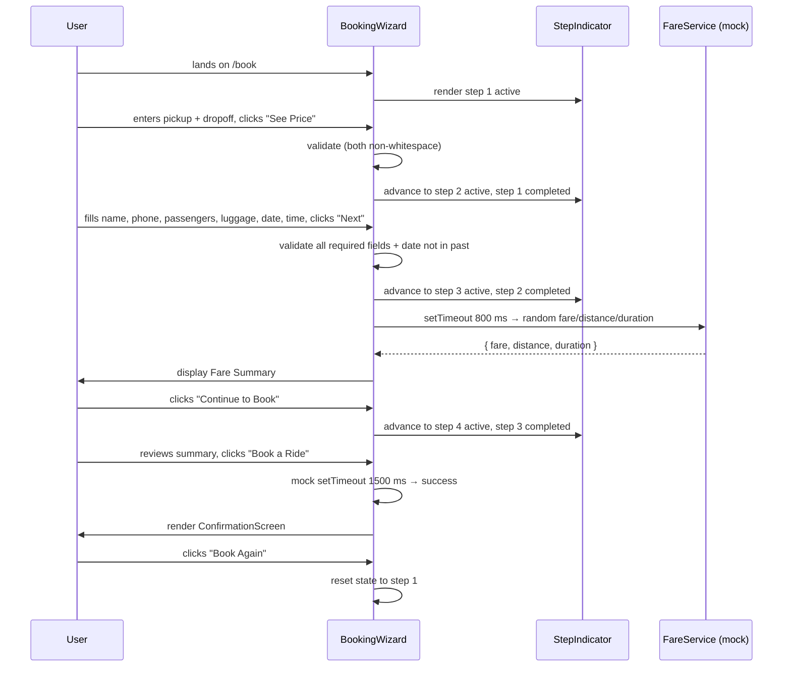
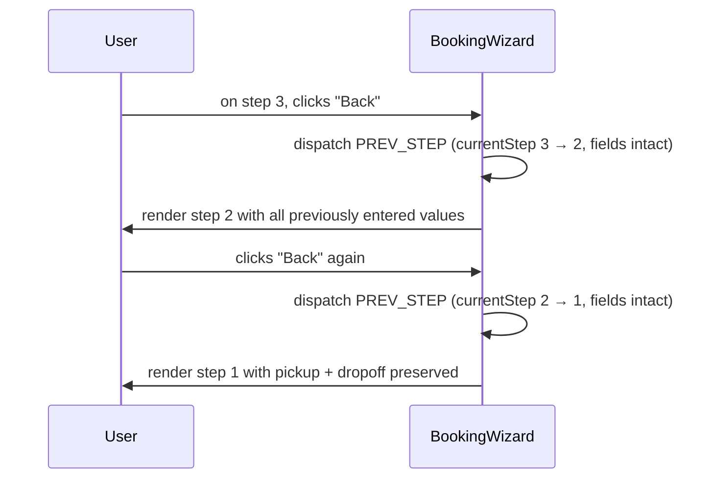

# Design Document: booking-form-multistep

## Overview

This feature replaces the single-screen `HomeBooking.tsx` form on `/book` with a four-step wizard (`BookingWizard.tsx`) that guides the user through route selection, journey details, fare preview, and final booking confirmation. Alongside the wizard, all gradient red colours across the site are replaced with flat solid equivalents so the visual language is consistent and renders correctly without CSS gradient support.

The implementation introduces two new components (`BookingWizard` and `StepIndicator`), modifies seven existing files to strip gradients, and updates `src/app/book/page.tsx` to import the wizard instead of the legacy form. No new npm dependencies are added; the project's existing Tailwind CSS, Lucide React, and React hooks are sufficient.

---

## Architecture

```mermaid
graph TD
    A[/book page.tsx] --> B[BookingWizard.tsx]
    B --> C[StepIndicator.tsx]
    B --> D{currentStep}
    D -->|1| E[Step1Route]
    D -->|2| F[Step2Details]
    D -->|3| G[Step3Fare]
    D -->|4| H[Step4Confirm]
    D -->|confirmed| I[ConfirmationScreen]
    B --> J[useReducer – WizardState]
    J --> E
    J --> F
    J --> G
    J --> H
    J --> I

    K[Gradient Removal] --> L[Button.tsx]
    K --> M[Header.tsx]
    K --> N[MobileMenu.tsx]
    K --> O[Hero.tsx]
    K --> P[CTA.tsx]
    K --> Q[Services.tsx]
    K --> R[HomeBooking.tsx]
```

---

## Sequence Diagrams

### Happy-path booking flow



### Back-navigation with state preservation



---

## Components and Interfaces

### BookingWizard (`src/components/booking/BookingWizard.tsx`)

**Purpose**: Root wizard component. Owns all state via `useReducer`, renders the `StepIndicator` plus the active step panel, and manages step transitions.

**Interface**:
```typescript
// No external props — self-contained
export default function BookingWizard(): JSX.Element
```

**Responsibilities**:
- Declare and manage `WizardState` with `useReducer`
- Dispatch `NEXT_STEP`, `PREV_STEP`, `SET_FIELD`, `SET_FARE`, `SET_STEP_ERROR`, `CONFIRM`, `RESET` actions
- Trigger fare mock on entering step 3
- Move keyboard focus to step heading on each step transition (`useEffect` + `ref`)
- Render `StepIndicator` with derived step status array
- Conditionally render Step1–4 panels or `ConfirmationScreen` based on `state.currentStep`

---

### StepIndicator (`src/components/booking/StepIndicator.tsx`)

**Purpose**: Purely presentational. Displays progress across the four named steps with active / completed / upcoming visual states that are distinguishable without colour alone.

**Interface**:
```typescript
interface StepInfo {
  label: string          // "Route" | "Details" | "Fare" | "Confirm"
  state: 'upcoming' | 'active' | 'completed'
}

interface StepIndicatorProps {
  steps: StepInfo[]
  currentStepNumber: number   // 1-based, for aria-label
}

export default function StepIndicator(props: StepIndicatorProps): JSX.Element
```

**Responsibilities**:
- Render four step items in a horizontal row
- `completed` state: filled circle with a **check icon** (Lucide `Check`) + label
- `active` state: filled circle with step number (bold) + label (white)
- `upcoming` state: outlined circle with step number (muted) + label (muted)
- Render connecting lines between steps; completed segments use red, upcoming segments use muted white
- Expose `aria-label="Step {n} of 4: {label}"` on the `<nav>` wrapper
- Each step circle is `aria-current="step"` when active, `aria-hidden` on purely decorative elements

---

### Step1Route (inline in BookingWizard or separate file)

**Purpose**: Renders pickup and dropoff text inputs plus the "See Price" CTA.

**Interface**:
```typescript
interface Step1Props {
  pickup: string
  dropoff: string
  errors: { pickup?: string; dropoff?: string }
  onChange: (field: 'pickup' | 'dropoff', value: string) => void
  onNext: () => void
  headingRef: React.RefObject<HTMLHeadingElement>
}
```

**Responsibilities**:
- Render labelled inputs with `id`/`for` pairs, `required` attr, and `aria-describedby` pointing to error `<p>` when error present
- Inline validation error beneath each field (visible only on failed submit attempt)
- "See Price" full-width button at bottom

---

### Step2Details (inline in BookingWizard or separate file)

**Purpose**: Collects name, phone, passengers, luggage, date, and time.

**Interface**:
```typescript
interface Step2Props {
  fields: Pick<WizardFields, 'name' | 'phone' | 'passengers' | 'luggage' | 'date' | 'time'>
  errors: Partial<Record<keyof Step2Props['fields'], string>>
  onChange: (field: string, value: string | number) => void
  onNext: () => void
  onBack: () => void
  headingRef: React.RefObject<HTMLHeadingElement>
}
```

**Responsibilities**:
- Name: `<input type="text" maxLength={100}>`, required
- Phone: `<input type="tel">`, required, regex validation `/^[+\d\s-]+$/`
- Passengers: `<select>` options 1–6, default 1
- Luggage: `<select>` options 0–6, default 0
- Date: `<input type="date">`, required, min set to today dynamically
- Time: `<input type="time">`, required
- "Back" and "Next" buttons side by side

---

### Step3Fare (inline in BookingWizard or separate file)

**Purpose**: Displays the mock fare summary with loading / error / success states.

**Interface**:
```typescript
interface Step3Props {
  fareState: 'loading' | 'ready' | 'error'
  fare: string          // "£12.50"
  distance: string      // "4.3 miles"
  duration: string      // "22 mins"
  onRetry: () => void
  onNext: () => void
  onBack: () => void
  headingRef: React.RefObject<HTMLHeadingElement>
}
```

**Responsibilities**:
- `loading`: spinner (animated Lucide `Loader2`) with "Calculating your fare…" text
- `error`: error message + "Retry" button
- `ready`: three metric cards (fare / distance / duration) + estimates disclaimer text
- "Back" and "Continue to Book" buttons

---

### Step4Confirm (inline in BookingWizard or separate file)

**Purpose**: Journey recap and final "Book a Ride" submit action.

**Interface**:
```typescript
interface Step4Props {
  summary: {
    pickup: string; dropoff: string; name: string
    date: string; time: string; passengers: number; luggage: number
    fare: string
  }
  submitting: boolean
  submitError: string | null
  onSubmit: () => void
  onBack: () => void
  headingRef: React.RefObject<HTMLHeadingElement>
}
```

**Responsibilities**:
- Summary list with labelled rows
- "Book a Ride" button: full-width, `py-5`, larger text — most visually prominent element on the page
- Disabled + spinner during `submitting`
- Inline error message below button when `submitError` is set
- "Back" link above or alongside summary

---

### ConfirmationScreen (inline in BookingWizard)

**Purpose**: Success state after mock submission.

**Responsibilities**:
- "Booking Confirmed!" heading
- Booking details recap (pickup, dropoff, name, date, time)
- "Book Again" button that dispatches `RESET`

---

## Data Models

### WizardState

```typescript
type WizardStep = 1 | 2 | 3 | 4 | 'confirmed'

interface FareData {
  fare: string          // formatted "£X.XX"
  distance: string      // formatted "X.X miles"
  duration: string      // formatted "X mins"
}

interface WizardFields {
  pickup: string
  dropoff: string
  name: string
  phone: string
  passengers: number    // 1–6
  luggage: number       // 0–6
  date: string          // ISO date string "YYYY-MM-DD"
  time: string          // "HH:MM"
}

type FareStatus = 'idle' | 'loading' | 'ready' | 'error'

interface WizardState {
  currentStep: WizardStep
  fields: WizardFields
  fareData: FareData | null
  fareStatus: FareStatus
  stepErrors: Partial<Record<keyof WizardFields, string>>
  submitError: string | null
  submitting: boolean
}
```

**Validation Rules**:
- `pickup`: non-empty after `.trim()`
- `dropoff`: non-empty after `.trim()`
- `name`: non-empty after `.trim()`, length ≤ 100
- `phone`: matches `/^[+\d\s-]+$/`
- `date`: non-empty, not before today's date (compare ISO strings)
- `time`: non-empty
- `passengers`: integer in [1, 6]
- `luggage`: integer in [0, 6]

### WizardAction (reducer actions)

```typescript
type WizardAction =
  | { type: 'SET_FIELD'; field: keyof WizardFields; value: string | number }
  | { type: 'SET_STEP_ERRORS'; errors: WizardState['stepErrors'] }
  | { type: 'NEXT_STEP' }
  | { type: 'PREV_STEP' }
  | { type: 'SET_FARE_LOADING' }
  | { type: 'SET_FARE_READY'; payload: FareData }
  | { type: 'SET_FARE_ERROR' }
  | { type: 'SET_SUBMITTING'; value: boolean }
  | { type: 'SET_SUBMIT_ERROR'; message: string }
  | { type: 'CONFIRM' }
  | { type: 'RESET' }
```

---

## Algorithmic Pseudocode

### validateStep1

```pascal
FUNCTION validateStep1(fields)
  INPUT: fields of type WizardFields
  OUTPUT: errors of type Record<string, string>

  errors ← {}

  IF fields.pickup.trim() = "" THEN
    errors.pickup ← "Please enter a pickup location"
  END IF

  IF fields.dropoff.trim() = "" THEN
    errors.dropoff ← "Please enter a drop-off location"
  END IF

  RETURN errors
END FUNCTION
```

**Preconditions**: `fields` is defined  
**Postconditions**: returns empty object when both fields have non-whitespace content; both error keys populated when both are empty

### validateStep2

```pascal
FUNCTION validateStep2(fields)
  INPUT: fields of type WizardFields
  OUTPUT: errors of type Record<string, string>

  errors ← {}
  today ← new Date() formatted as "YYYY-MM-DD"

  IF fields.name.trim() = "" THEN
    errors.name ← "Please enter your full name"
  ELSE IF fields.name.length > 100 THEN
    errors.name ← "Name must be 100 characters or fewer"
  END IF

  IF NOT /^[+\d\s-]+$/.test(fields.phone) THEN
    errors.phone ← "Enter a valid phone number"
  END IF

  IF fields.date = "" THEN
    errors.date ← "Please select a date"
  ELSE IF fields.date < today THEN
    errors.date ← "Date must be today or in the future"
  END IF

  IF fields.time = "" THEN
    errors.time ← "Please select a time"
  END IF

  RETURN errors
END FUNCTION
```

**Preconditions**: `fields.passengers` ∈ [1,6], `fields.luggage` ∈ [0,6] (enforced by select options)  
**Postconditions**: returns empty object only when all four required fields pass; date check uses local date comparison

### mockFareCalculation

```pascal
PROCEDURE mockFareCalculation(dispatch)
  INPUT: dispatch function

  dispatch(SET_FARE_LOADING)

  WAIT 800 ms

  TRY
    baseFare ← 8.0 + Math.random() * 42.0
    fare     ← "£" + baseFare.toFixed(2)
    miles    ← (1.5 + Math.random() * 28.5).toFixed(1) + " miles"
    mins     ← Math.floor(5 + Math.random() * 85) + " mins"

    dispatch(SET_FARE_READY, { fare, distance: miles, duration: mins })
  CATCH error
    dispatch(SET_FARE_ERROR)
  END TRY
END PROCEDURE
```

**Postconditions**: `fareStatus` transitions from `loading` → `ready` after 800 ms under normal conditions; `fareStatus` transitions to `error` if the setTimeout callback throws (defensive guard)

### mockBookingSubmit

```pascal
PROCEDURE mockBookingSubmit(dispatch)
  INPUT: dispatch function

  dispatch(SET_SUBMITTING, true)
  dispatch(SET_SUBMIT_ERROR, null)

  WAIT 1500 ms

  // Simulate 95% success rate for demo
  IF Math.random() > 0.05 THEN
    dispatch(CONFIRM)
  ELSE
    dispatch(SET_SUBMIT_ERROR, "Submission failed. Please try again.")
  END IF

  dispatch(SET_SUBMITTING, false)
END PROCEDURE
```

**Postconditions**: on success, `currentStep` = `"confirmed"`; on failure, `submitError` is set and `currentStep` remains 4

### wizardReducer (key transitions)

```pascal
FUNCTION wizardReducer(state, action)
  MATCH action.type

    CASE "NEXT_STEP":
      RETURN { ...state, currentStep: state.currentStep + 1, stepErrors: {} }

    CASE "PREV_STEP":
      RETURN { ...state, currentStep: state.currentStep - 1, stepErrors: {} }

    CASE "SET_FIELD":
      RETURN { ...state, fields: { ...state.fields, [action.field]: action.value } }

    CASE "SET_STEP_ERRORS":
      RETURN { ...state, stepErrors: action.errors }

    CASE "SET_FARE_LOADING":
      RETURN { ...state, fareStatus: "loading", fareData: null }

    CASE "SET_FARE_READY":
      RETURN { ...state, fareStatus: "ready", fareData: action.payload }

    CASE "SET_FARE_ERROR":
      RETURN { ...state, fareStatus: "error" }

    CASE "CONFIRM":
      RETURN { ...state, currentStep: "confirmed" }

    CASE "RESET":
      RETURN initialState

    DEFAULT:
      RETURN state
  END MATCH
END FUNCTION
```

**Loop Invariants**: N/A (reducer is a pure switch with no loops)  
**Postconditions**: state is always a new object (no mutation); `fields` object is never partially updated

---

## Key Functions with Formal Specifications

### handleStep1Next

```typescript
function handleStep1Next(): void
```

**Preconditions**: `state.currentStep === 1`  
**Postconditions**:
- If `validateStep1` returns non-empty errors → `state.stepErrors` is set; `currentStep` unchanged
- If validation passes → `state.currentStep === 2`; `state.stepErrors === {}`
- Focus moves to step-2 heading element

### handleStep2Next

```typescript
function handleStep2Next(): void
```

**Preconditions**: `state.currentStep === 2`  
**Postconditions**:
- If `validateStep2` returns non-empty errors → `state.stepErrors` is set; `currentStep` unchanged
- If validation passes → `state.currentStep === 3`; `mockFareCalculation` is invoked; focus moves to step-3 heading

### handleBack

```typescript
function handleBack(): void
```

**Preconditions**: `state.currentStep` ∈ {2, 3, 4}  
**Postconditions**: `currentStep` decrements by 1; all `fields` values unchanged; `stepErrors` cleared; focus moves to new step heading

---

## Focus Management

```pascal
// Called after every step transition
PROCEDURE moveFocusToStepHeading(headingRef)
  IF headingRef.current IS NOT NULL THEN
    headingRef.current.setAttribute("tabindex", "-1")
    headingRef.current.focus()
  END IF
END PROCEDURE
```

Each step panel receives a `ref` attached to its `<h2>`. A `useEffect` depending on `state.currentStep` calls this procedure after render.

---

## Gradient Removal — Change Specification

All changes replace CSS gradient declarations with flat solid colours. No layout, sizing, or animation changes are made.

### `src/components/ui/Button.tsx`

| Location | Before | After |
|---|---|---|
| `primary` variant class | `bg-gradient-to-r from-[#FF1D25] to-[#D90012]` | `bg-[#FF1D25]` |

Shadow and hover classes remain unchanged.

### `src/components/layout/Header.tsx`

| Location | Before | After |
|---|---|---|
| "Contact Now" link `background` style | `linear-gradient(135deg, #FF1D25, #D90012)` | `#FF1D25` |

### `src/components/layout/MobileMenu.tsx`

| Location | Before | After |
|---|---|---|
| "Contact Now" link `background` style | `linear-gradient(135deg, #FF1D25, #D90012)` | `#FF1D25` |

### `src/components/home/Hero.tsx`

| Location | Before | After |
|---|---|---|
| Section `background` style (two nested `linear-gradient`) | `linear-gradient(90deg, ...), linear-gradient(180deg, ...)` | `#050505` (single flat colour) |
| Red glow orb `<div>` | `radial-gradient(circle, ...)` background + blur | **Remove entire orb `<div>`** |
| Road streak `<div>` items | `linear-gradient(90deg, transparent, #FF1D25, transparent)` background | **Remove entire road streaks block** |
| Car image soft glow `<div>` | `radial-gradient(ellipse ..., rgba(255,29,37,0.2), transparent)` | **Remove that inner `<div>`** |

The hero section retains its layout, typography, trust points, motion animations, and car image. Only decorative gradient overlays are stripped.

### `src/components/home/CTA.tsx`

| Location | Before | After |
|---|---|---|
| Card `background` style | `linear-gradient(135deg, #FF1D25 0%, #D90012 50%, #8B0000 100%)` | `#D90012` |
| Dot pattern `<div>` `backgroundImage` | `radial-gradient(circle, white 1px, transparent 1px)` | **Remove entire dot pattern `<div>`** |

### `src/components/home/Services.tsx`

| Location | Before | After |
|---|---|---|
| Service card `background` style | `linear-gradient(180deg, rgba(255,255,255,0.05), rgba(255,255,255,0.02))` | `rgba(255,255,255,0.04)` |
| Icon box `background` style | `linear-gradient(135deg, #FF1D25, #D90012)` | `#FF1D25` |

### `src/components/home/HomeBooking.tsx`

| Location | Before | After |
|---|---|---|
| Submit button `background` style | `linear-gradient(135deg, #FF1D25, #D90012)` | `#FF1D25` |
| Confirmation icon circle `background` style | `linear-gradient(135deg, #FF1D25, #D90012)` | `#FF1D25` |

> Note: `HomeBooking.tsx` will no longer be rendered on `/book` once `BookingWizard` is live, but it may remain used elsewhere (e.g. embedded in home page sections), so the gradient is still removed.

---

## Error Handling

### Validation Errors (Steps 1 & 2)

**Condition**: User clicks next/submit with missing or invalid field values  
**Response**: `stepErrors` map is populated; each field with an error renders an `<p id="{field}-error" role="alert" aria-live="polite">` below the input; the input gains `aria-describedby="{field}-error"`  
**Recovery**: Error clears when user corrects the field and re-submits

### Fare Calculation Error (Step 3)

**Condition**: `mockFareCalculation` throws (edge case in mock)  
**Response**: `fareStatus` set to `"error"`; display "Unable to calculate fare" + "Retry" button  
**Recovery**: "Retry" dispatches `SET_FARE_LOADING` and re-runs `mockFareCalculation`

### Booking Submission Error (Step 4)

**Condition**: Mock returns failure path  
**Response**: `submitError` string set; red error message rendered below "Book a Ride" button; `currentStep` stays at 4  
**Recovery**: User clicks "Book a Ride" again to retry

---

## Testing Strategy

### Unit Testing Approach

Test the `wizardReducer` in isolation for every action type. Key cases:
- `NEXT_STEP` increments step and clears `stepErrors`
- `PREV_STEP` decrements step without touching `fields`
- `SET_FIELD` updates only the targeted field key
- `RESET` returns exact `initialState`
- `CONFIRM` sets `currentStep` to `"confirmed"`

Test `validateStep1` and `validateStep2` pure functions:
- Empty string → error present
- Whitespace-only string → error present
- Valid value → no error
- Date in past → `date` error present
- Name > 100 chars → `name` error present
- Phone with letters → `phone` error

### Property-Based Testing Approach

**Property Test Library**: fast-check

```typescript
// Property: validateStep1 returns no errors iff both fields are non-whitespace
fc.assert(
  fc.property(
    fc.string().filter(s => s.trim().length > 0),
    fc.string().filter(s => s.trim().length > 0),
    (pickup, dropoff) => {
      const errors = validateStep1({ pickup, dropoff, ...defaultFields })
      return Object.keys(errors).length === 0
    }
  )
)

// Property: back navigation never mutates fields
fc.assert(
  fc.property(fc.record({ pickup: fc.string(), dropoff: fc.string(), name: fc.string() }), (fields) => {
    const state = { ...initialState, fields: { ...initialState.fields, ...fields }, currentStep: 2 as const }
    const next = wizardReducer(state, { type: 'PREV_STEP' })
    return JSON.stringify(next.fields) === JSON.stringify(state.fields)
  })
)
```

### Integration Testing Approach

Using React Testing Library against `BookingWizard`:
- Fill Step 1, click "See Price" → step indicator shows step 2 active
- Click "Back" from step 2 → pickup/dropoff values preserved
- Wait for fare loading → fare values appear (mock timers via `jest.useFakeTimers`)
- Complete all steps → confirmation screen visible with submitted data
- "Book Again" → wizard resets to step 1, all inputs empty

---

## Performance Considerations

- `useReducer` with a single flat state object prevents excessive re-renders; each step panel only reads the slice it needs
- The `BookingWizard` is a `'use client'` component; the `/book` page shell can remain a Server Component
- Mock timers (`setTimeout`) are negligible; no network calls are made
- `StepIndicator` is purely presentational with no side effects and re-renders only when `currentStep` changes

---

## Security Considerations

- All form data is client-side only; no data is transmitted in this feature (mock submission)
- Phone regex `/^[+\d\s-]+$/` prevents injection of unexpected characters before any future real submission
- Date validation (`min` attribute + JS check) prevents submission of past dates client-side
- `maxLength={100}` on the name field is enforced both via HTML attribute and JS validation

---

## Correctness Properties

These universal invariants must hold at every point in the wizard's lifecycle.

### Property 1: Step field preservation

Back navigation never mutates field values.

∀ state where `currentStep` ∈ {2, 3, 4}: `wizardReducer(state, PREV_STEP).fields` deep-equals `state.fields`.

**Validates: Requirements 7.1, 7.2, 7.3, 7.4**

### Property 2: Validation gate

Advancing to the next step is only possible when the current step's validator returns no errors.

∀ inputs: `NEXT_STEP` is dispatched only after `validateStepN` returns `{}`; if errors exist, `currentStep` is unchanged.

**Validates: Requirements 2.3, 2.4, 2.5, 3.6, 3.7, 3.8, 3.10, 3.11, 3.12**

### Property 3: Error-field association

Every validation error string present in `stepErrors` has a corresponding `aria-describedby` link on the associated input.

∀ key `k` in `stepErrors`: the input with `id="{k}"` has `aria-describedby="{k}-error"` and a rendered `<p id="{k}-error">` in the DOM.

**Validates: Requirements 8.2**

### Property 4: State reset completeness

After `RESET`, `wizardReducer` returns a state deeply equal to `initialState`; no field value from a previous booking can bleed through.

`wizardReducer(anyState, { type: 'RESET' })` deepEquals `initialState`.

**Validates: Requirements 6.3**

### Property 5: Fare loading sequence

`fareStatus` only ever transitions in the direction `idle → loading → (ready | error)`. It never jumps from `idle` directly to `ready`, and never regresses from `ready` to `loading` without an explicit retry action dispatching `SET_FARE_LOADING`.

**Validates: Requirements 4.4, 4.5**

### Property 6: Submission idempotency

While `submitting === true`, the "Book a Ride" button is disabled; duplicate submissions cannot be triggered.

∀ state where `submitting === true`: `Book_a_Ride_Button.disabled === true`.

**Validates: Requirements 5.4, 5.5**

### Property 7: Confirmation immutability

Once `currentStep === "confirmed"`, no action other than `RESET` changes the state; stale dispatches (e.g., lingering `setTimeout` callbacks from step 3 or 4) are no-ops.

**Validates: Requirements 6.1, 6.2**

### Property 8: Passenger and luggage bounds

`passengers` ∈ [1, 6] and `luggage` ∈ [0, 6] at all times. Select elements enforce this by construction; the reducer preserves the value unchanged on `SET_FIELD` since selects only emit valid option values.

**Validates: Requirements 3.2, 3.3**

---

## Dependencies

All existing; no new packages required:

| Dependency | Usage |
|---|---|
| `react` (hooks) | `useReducer`, `useState`, `useEffect`, `useRef` |
| `lucide-react` | Icons: `MapPin`, `Navigation`, `Users`, `Luggage`, `Calendar`, `Clock`, `Check`, `Loader2`, `CheckCircle`, `ArrowLeft`, `ChevronRight` |
| `tailwindcss` | All layout and styling |
| `next/navigation` | N/A in wizard (no route changes) |
