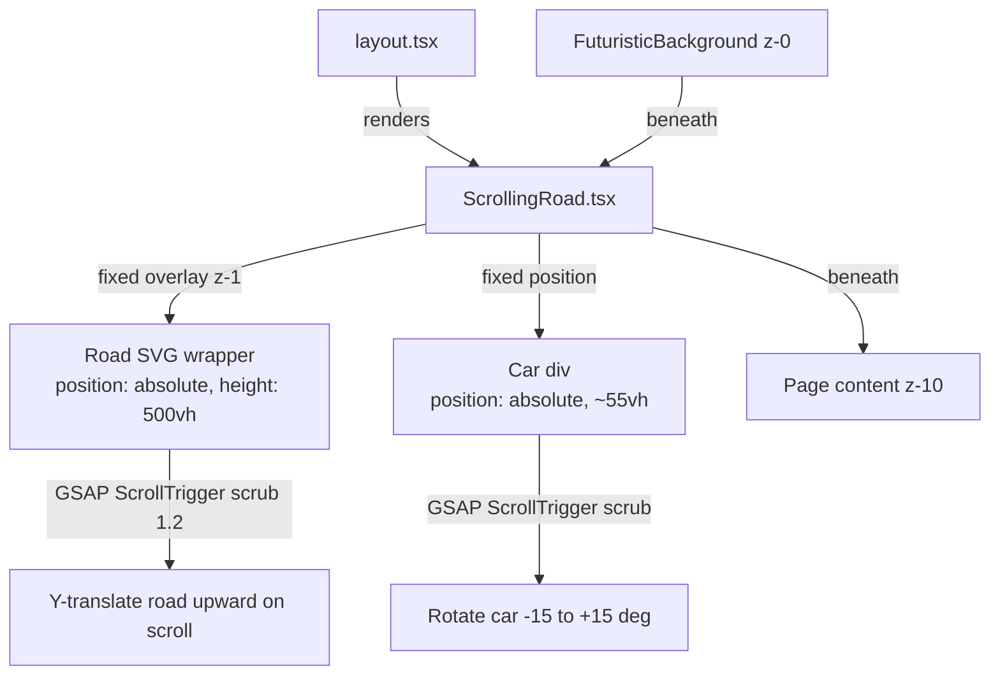
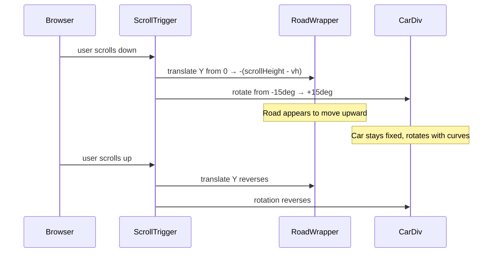

# Design Document: Scrolling Road Background

## Overview

Replace the existing `ScrollingRoad` component — which moves a car along a fixed road — with an inverted "moving road / fixed car" approach. A tall winding SVG road scrolls vertically (driven by GSAP ScrollTrigger) while the car stays pinned at roughly 55% viewport height, creating a top-down driving-game feel. The component is mounted once in the global layout so the effect appears on every page.

## Architecture





## Components and Interfaces

### Component: ScrollingRoad

**Purpose**: Fixed-position background layer that renders a winding SVG road scrolling in sync with page scroll, with a pinned car image that rotates to match road curves.

**Interface**:
```typescript
// No props — self-contained, mounts once in layout
export default function ScrollingRoad(): JSX.Element
```

**Responsibilities**:
- Render the fixed overlay container (`position: fixed, inset: 0, z-index: 1, pointer-events: none`)
- Render the tall SVG road wrapper (`position: absolute, height: 500vh`) inside the fixed container
- Render the car image pinned at `~55%` viewport height, horizontally centered
- Register GSAP `ScrollTrigger` and `MotionPathPlugin` on mount
- Animate road wrapper Y from `0` to `-(totalScrollHeight - viewportHeight)` via `ScrollTrigger scrub: 1.2`
- Animate car rotation between `-15deg` and `+15deg` via a separate `ScrollTrigger scrub` tween
- Clean up GSAP context on unmount via `ctx.revert()`

### Component: layout.tsx (modified)

**Purpose**: Root layout that mounts `ScrollingRoad` once for all pages.

**Interface**: No change to public API — adds `<ScrollingRoad />` inside `<body>` before `{children}`.

**Responsibilities**:
- Import and render `<ScrollingRoad />` between `<FuturisticBackground />` and `<Header />`
- Ensure page `<main>` retains `position: relative; z-index: 10`

## Data Models

### SVG Road Path

```typescript
// Single path string shared by all road layers — defined once as a JS const
const ROAD_PATH =
  "M 200 0 " +
  "C 200 200, 80 280, 80 500 " +
  "C 80 720, 320 800, 320 1000 " +
  "C 320 1200, 80 1280, 80 1500 " +
  "C 80 1720, 320 1800, 320 2000 " +
  "C 320 2200, 200 2400, 200 2500 " +
  "C 200 2600, 80 2700, 80 2800 " +
  "C 80 2900, 200 2950, 200 3000";
```

**Validation Rules**:
- Path must start at `(200, 0)` and end at `(200, 3000)` so it spans the full SVG height
- All control points must stay within `x: 40–360` to remain visible within the viewport-centred SVG
- Must produce smooth S-curves — no abrupt direction reversals

### Road Layer Stack

```typescript
interface RoadLayer {
  stroke: string;       // CSS color value
  strokeWidth: number;  // SVG units
  strokeDasharray?: string;
  filter?: string;      // SVG filter id reference
}

const ROAD_LAYERS: RoadLayer[] = [
  { stroke: 'rgba(0,0,0,0.45)',          strokeWidth: 52 },                          // shadow
  { stroke: 'rgba(255,255,255,0.07)',    strokeWidth: 38 },                          // surface
  { stroke: 'rgba(204,32,14,0.50)',      strokeWidth: 2,  filter: 'url(#roadGlow)' }, // left kerb
  { stroke: 'rgba(204,32,14,0.28)',      strokeWidth: 1.5 },                         // right kerb
  { stroke: 'rgba(204,32,14,0.45)',      strokeWidth: 1.2, strokeDasharray: '14 12' } // centre line
];
```

### Scroll Animation Config

```typescript
interface ScrollAnimConfig {
  roadY: {
    from: number;        // 0 — road starts at natural top position
    to: number;          // computed: -(document.body.scrollHeight - window.innerHeight)
    scrub: number;       // 1.2 — lag behind scroll for driving feel
  };
  carRotation: {
    from: number;        // -15 (degrees)
    to: number;          // +15 (degrees)
    scrub: number;       // 1.5 — slightly more lag than road
  };
  trigger: {
    trigger: string;     // 'body'
    start: string;       // 'top top'
    end: string;         // 'bottom bottom'
  };
}
```

## Algorithmic Pseudocode

### Main Mount Algorithm

```pascal
ALGORITHM mountScrollingRoad()
INPUT: roadRef (SVG wrapper element), carRef (car div element)
OUTPUT: GSAP context (for cleanup)

BEGIN
  ASSERT roadRef.current ≠ null
  ASSERT carRef.current ≠ null

  ctx ← gsap.context()

  // Road translation — moves road upward as user scrolls down
  totalScroll ← document.body.scrollHeight - window.innerHeight
  
  gsap.to(roadRef.current, {
    y: -totalScroll,
    ease: 'none',
    scrollTrigger: {
      trigger: document.body,
      start: 'top top',
      end: 'bottom bottom',
      scrub: 1.2
    }
  })

  // Car rotation — tracks road curve direction
  gsap.fromTo(carRef.current,
    { rotate: -15 },
    {
      rotate: 15,
      ease: 'none',
      scrollTrigger: {
        trigger: document.body,
        start: 'top top',
        end: 'bottom bottom',
        scrub: 1.5
      }
    }
  )

  RETURN ctx
END
```

**Preconditions:**
- Both refs are mounted and point to DOM elements
- GSAP `ScrollTrigger` is registered before this runs
- Runs inside `useEffect` (browser-only, no SSR)

**Postconditions:**
- Road wrapper animates Y from `0` to `-(scrollHeight - vh)` over full page scroll
- Car rotates from `-15deg` to `+15deg` over full page scroll
- Both tweens are tied to the same `document.body` scroll trigger

**Loop Invariants:** N/A — timeline-driven, not iterative

### Cleanup Algorithm

```pascal
ALGORITHM cleanupScrollingRoad(ctx)
INPUT: gsap context returned by mountScrollingRoad
OUTPUT: void

BEGIN
  ctx.revert()
  // Kills all ScrollTrigger instances and tweens created in the context
END
```

**Preconditions:** `ctx` is a valid GSAP context object
**Postconditions:** All animations and ScrollTrigger instances created in context are destroyed

### SVG Layout Algorithm

```pascal
ALGORITHM buildRoadSVG(roadPath)
INPUT: roadPath (shared path string)
OUTPUT: SVG element with layered road paths and fade mask

BEGIN
  // Define shared defs
  defs ← [linearGradient(roadFade), mask(roadMask), filter(roadGlow)]

  // Build road layers (bottom → top)
  FOR each layer IN ROAD_LAYERS DO
    path ← <path d={roadPath} stroke={layer.stroke} strokeWidth={layer.strokeWidth} />
    IF layer.strokeDasharray THEN path.strokeDasharray ← layer.strokeDasharray END
    IF layer.filter THEN path.filter ← layer.filter END
    group.append(path)
  END FOR

  // Apply fade mask to group
  group.mask ← 'url(#roadMask)'

  RETURN svg(viewBox='0 0 400 3000', group)
END
```

## Key Functions with Formal Specifications

### useEffect hook — GSAP initialisation

```typescript
useEffect(() => {
  if (!roadRef.current || !carRef.current) return;
  const ctx = gsap.context(() => { /* animations */ });
  return () => ctx.revert();
}, []);
```

**Preconditions:**
- `roadRef.current` and `carRef.current` are non-null (component is mounted)
- `ScrollTrigger` and `MotionPathPlugin` are registered at module scope

**Postconditions:**
- Two GSAP tweens (road Y, car rotation) are active, both scrubbed to `document.body` scroll
- On component unmount, `ctx.revert()` removes all tweens and ScrollTrigger instances

**Loop Invariants:** N/A

### computeRoadTranslation

```typescript
function computeRoadTranslation(): number
```

**Preconditions:** Called inside `useEffect` (browser environment, DOM available)
**Postconditions:**
- Returns `-(document.body.scrollHeight - window.innerHeight)` as a negative pixel value
- Returns `0` if `document.body.scrollHeight <= window.innerHeight` (no scroll available)

## Example Usage

```tsx
// src/app/layout.tsx — mount once for site-wide effect
import ScrollingRoad from '@/components/ui/ScrollingRoad';

export default function RootLayout({ children }: { children: React.ReactNode }) {
  return (
    <html lang="en">
      <body className="min-h-screen flex flex-col bg-[#050505] text-white antialiased">
        <FuturisticBackground />   {/* z-0 */}
        <ScrollingRoad />          {/* z-1 — NEW */}
        <Header />
        <main className="flex-1 relative z-10">{children}</main>
        <Footer />
        <FloatingWidgets />
      </body>
    </html>
  );
}
```

```tsx
// src/app/airport-transfers/page.tsx — REMOVE individual usage
// DELETE: import ScrollingRoad from '@/components/ui/ScrollingRoad';
// DELETE: <ScrollingRoad /> inside the page JSX
```

## Error Handling

### Scenario 1: Refs not ready on mount

**Condition**: `roadRef.current` or `carRef.current` is null when `useEffect` fires (rare SSR/hydration edge case)
**Response**: Early return from effect — no animation is registered
**Recovery**: Component renders correctly without animation; no error thrown

### Scenario 2: Zero scrollable height

**Condition**: `document.body.scrollHeight === window.innerHeight` (page fits in one screen)
**Response**: `computeRoadTranslation()` returns `0` — road does not translate
**Recovery**: Component renders with road visible but static; car still visible at fixed position

### Scenario 3: GSAP not available (SSR)

**Condition**: `useEffect` never runs during server-side render
**Response**: Component renders static HTML with road SVG and car image — no animation
**Recovery**: On client hydration, `useEffect` fires and animations activate

### Scenario 4: Layout z-index conflict

**Condition**: Page content does not have `z-index: 10` set
**Response**: Road may render on top of content
**Recovery**: Layout `<main>` has `className="flex-1 relative z-10"` — explicitly documented requirement

## Testing Strategy

### Unit Testing Approach

Test the pure helper logic and SVG structure:
- Verify `computeRoadTranslation()` returns a non-positive number
- Verify `computeRoadTranslation()` returns `0` when scroll height ≤ viewport height
- Verify the ROAD_PATH string starts at `M 200 0` and ends at `200 3000`
- Verify ROAD_LAYERS array has exactly 5 entries with correct stroke properties

### Property-Based Testing Approach

**Property Test Library**: fast-check (already used in project — see `src/__tests__/fareAndSubmit.property.test.ts`)

Property tests focus on the pure transformation functions:
- **Road translation invariant**: For any positive page height and viewport height, the computed road Y translation is always ≤ 0 and ≥ `-(pageHeight - viewportHeight)`
- **Rotation bounds**: Car rotation value is always within `[-15, +15]` degrees for any scroll progress in `[0, 1]`

### Integration Testing Approach

- Render `ScrollingRoad` in a JSDOM environment with mocked GSAP
- Verify fixed container renders with `z-index: 1`, `pointer-events: none`
- Verify car image uses `src="/images/fleet/hero-car.png"`
- Verify road SVG renders with `viewBox="0 0 400 3000"`

## Performance Considerations

- `will-change: transform` on the road SVG wrapper enables GPU compositing layer, preventing main-thread repaints during scroll
- `pointer-events: none` on the entire container ensures zero impact on user interactions
- The SVG uses a single shared path string — no duplicated path data in the DOM
- GSAP ScrollTrigger `scrub` defers animation frames to rAF, keeping scroll handler lightweight
- Road is `height: 500vh` — tall enough to span 5 viewport heights worth of scroll without tiling

## Security Considerations

- Component renders static SVG paths — no user input processed, no XSS surface
- Image source is a local `/public` path — no external fetch
- `aria-hidden="true"` on the container ensures screen readers skip the decorative animation

## Dependencies

- `gsap ^3.15.0` — already installed (`gsap/ScrollTrigger`, `gsap/MotionPathPlugin`)
- `next/image` — already available (Next.js 16 App Router)
- No new dependencies required

---

## Correctness Properties

*A property is a characteristic or behavior that should hold true across all valid executions of a system — essentially, a formal statement about what the system should do. Properties serve as the bridge between human-readable specifications and machine-verifiable correctness guarantees.*

### Property 1: Road translation is always non-positive and bounded

*For any* combination of `scrollHeight` and `viewportHeight` — whether the page is scrollable or not — `computeRoadTranslation(scrollHeight, viewportHeight)` must return exactly `-(scrollHeight - viewportHeight)` when `scrollHeight > viewportHeight`, and exactly `0` when `scrollHeight ≤ viewportHeight`. The result is always ≤ `0`.

**Validates: Requirements 2.2, 2.5**

### Property 2: Car rotation is bounded within safe range

*For any* scroll progress value in `[0, 1]`, the interpolated car rotation must fall within `[-15, +15]` degrees inclusive.

**Validates: Requirements 3.3**

### Property 3: Road path control points remain within viewport-visible bounds

*For any* invocation of `ROAD_PATH`, the path string must start with `M 200 0` and all cubic bezier X coordinate values (including control points) must be within `[40, 360]`, so every part of the road remains visible within the `400`-unit-wide SVG viewport.

**Validates: Requirements 1.2**

### Property 4: All road layers share identical path geometry

*For any* rendered `<path>` element inside the road SVG group, the `d` attribute must equal the value of `ROAD_PATH` — no layer may deviate from the shared path definition.

**Validates: Requirements 1.3**
