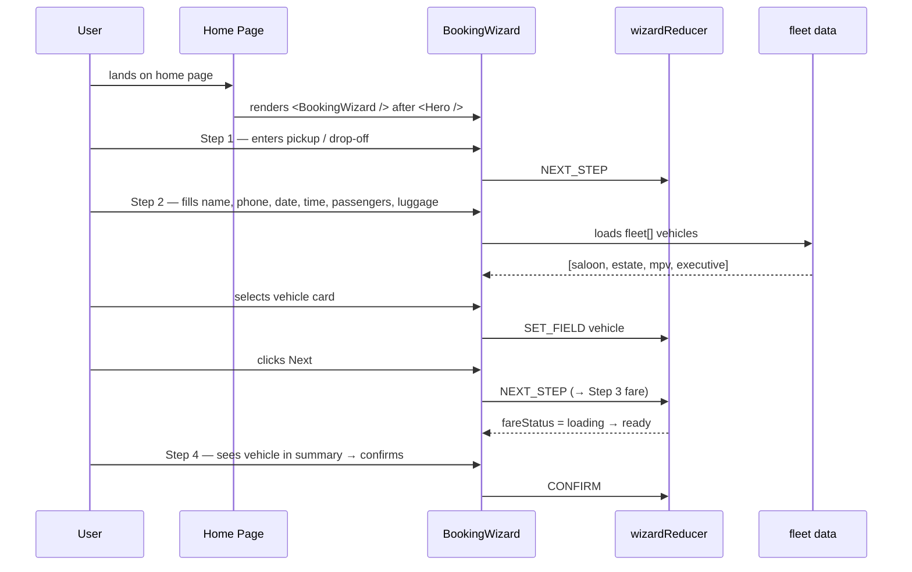

# Design Document: UI Alignment & Booking Enhancements

## Overview

Three focused UI improvements to the Bittacy Cars Next.js website: standardising container widths and spacing across all content pages, surfacing the `BookingWizard` directly on the home page after the `Hero` section, and adding a fleet vehicle selector to Step 2 of the wizard so customers can pick their vehicle type before seeing the fare estimate.

---

## Architecture

The changes are purely frontend and confined to the Next.js app directory and shared components. No new routes, API endpoints, or backend changes are required.

- **Pages** (`src/app/*/page.tsx`) — alignment token fixes applied in-place
- **Home page** (`src/app/page.tsx`) — `<BookingWizard />` inserted after `<Hero />`
- **BookingWizard** (`src/components/booking/BookingWizard.tsx`) — `WizardFields` extended with `vehicle`, new `VehicleSelector` rendered in Step 2
- **VehicleSelector** (`src/components/booking/VehicleSelector.tsx`) — new client component, reads `fleet` data, renders selectable cards

## Components and Interfaces

### VehicleSelector (new)

```typescript
interface VehicleSelectorProps {
  vehicles:   FleetVehicle[]
  selectedId: string
  passengers: number
  onSelect:   (id: string) => void
}
```

Renders 4 fleet cards. Active card gets red border + checkmark overlay. Cards whose `passengers` capacity < current `passengers` field are disabled (`opacity-40 pointer-events-none aria-disabled="true"`).

### BookingWizard (modified)

`WizardFields` gains `vehicle: string` (default `''`). Step 2 gains `<VehicleSelector />` below existing fields. Step 4 summary and confirmation screen conditionally render a "Vehicle" row.

## Data Models

```typescript
// Extended — vehicle field added
interface WizardFields {
  pickup:     string
  dropoff:    string
  name:       string
  phone:      string
  passengers: number
  luggage:    number
  date:       string
  time:       string
  vehicle:    string   // FleetVehicle.id or '' (not selected)
}

// Alignment tokens (applied as Tailwind classes)
interface ContainerTokens {
  heroInner:    'max-w-4xl mx-auto text-center'
  contentInner: 'max-w-7xl mx-auto'
  narrowInner:  'max-w-5xl mx-auto'
  ctaInner:     'max-w-3xl mx-auto text-center'
}
```

## Main Algorithm / Workflow



---

## Core Interfaces / Types

```typescript
// Existing — no change
interface FleetVehicle {
  id: string        // 'saloon' | 'estate' | 'mpv' | 'executive'
  name: string
  passengers: number
  luggage: number
  image: string     // e.g. '/images/fleet/Saloon.png'
}

// Extended WizardFields — add vehicle field
interface WizardFields {
  pickup:     string
  dropoff:    string
  name:       string
  phone:      string
  passengers: number
  luggage:    number
  date:       string
  time:       string
  vehicle:    string   // NEW — FleetVehicle.id, empty string = not yet selected
}

// WizardAction union — no new action types needed;
// SET_FIELD with field='vehicle' handles selection.
type WizardAction =
  | { type: 'SET_FIELD'; field: keyof WizardFields; value: string | number }
  | { type: 'SET_STEP_ERRORS'; errors: WizardState['stepErrors'] }
  | { type: 'NEXT_STEP' }
  | { type: 'PREV_STEP' }
  | { type: 'SET_FARE_LOADING' }
  | { type: 'SET_FARE_READY'; payload: FareData }
  | { type: 'SET_FARE_ERROR' }
  | { type: 'SET_SUBMITTING'; value: boolean }
  | { type: 'SET_SUBMIT_ERROR'; message: string | null }
  | { type: 'CONFIRM' }
  | { type: 'RESET' }

// Alignment token — defines the standard container pattern
interface ContainerTokens {
  outerPadding: string   // 'px-4 sm:px-6 lg:px-8'
  heroInner:    string   // 'max-w-4xl mx-auto text-center'
  contentInner: string   // 'max-w-7xl mx-auto'
  narrowInner:  string   // 'max-w-5xl mx-auto'  (coverage grids, how-it-works)
  ctaInner:     string   // 'max-w-3xl mx-auto text-center'
}
```

---

## Key Functions with Formal Specifications

### `validateStep2(fields)` — extended

```typescript
function validateStep2(
  fields: Pick<WizardFields, 'name' | 'phone' | 'date' | 'time'>
): Partial<Record<'name' | 'phone' | 'date' | 'time', string>>
```

**Preconditions:**
- `fields` is non-null
- `fields.date` is an ISO date string or empty string

**Postconditions:**
- Returns an empty object when all four fields pass their rules
- Returns `{ name: '…' }` when `name.trim()` is empty or length > 100
- Returns `{ phone: '…' }` when phone does not match `/^[+\d\s-]+$/`
- Returns `{ date: '…' }` when date is empty or before today's ISO date
- Returns `{ time: '…' }` when time is empty
- Vehicle selection is **not** validated here — it is optional (no validation gate)
- No side effects on `fields`

**Loop invariants:** N/A

---

### `VehicleSelector` component (new)

```typescript
function VehicleSelector({
  vehicles,
  selectedId,
  passengers,
  onSelect,
}: {
  vehicles:   FleetVehicle[]
  selectedId: string
  passengers: number          // from wizard fields; used to auto-filter eligible cards
  onSelect:   (id: string) => void
}): JSX.Element
```

**Preconditions:**
- `vehicles` is a non-empty array from `fleet.ts`
- `selectedId` is either `''` or a valid `FleetVehicle.id`
- `passengers` ≥ 1

**Postconditions:**
- Renders one card per `FleetVehicle` in `vehicles`
- Card whose `id === selectedId` has visually distinct active state (red border + checkmark)
- Cards with `vehicle.passengers < passengers` are rendered disabled (reduced opacity, `pointer-events-none`)
- Calling `onSelect(id)` with a non-disabled vehicle fires the callback exactly once
- Calling `onSelect` on a disabled vehicle is impossible via UI
- No side effects beyond calling `onSelect`

**Loop invariants:**
- For each rendered card in order: card rendering is independent of other cards

---

### `wizardReducer` — `initialState` update

```typescript
export const initialState: WizardState = {
  currentStep: 1,
  fields: {
    pickup:     '',
    dropoff:    '',
    name:       '',
    phone:      '',
    passengers: 1,
    luggage:    0,
    date:       '',
    time:       '',
    vehicle:    '',   // NEW default — no vehicle selected
  },
  fareData:    null,
  fareStatus:  'idle',
  stepErrors:  {},
  submitError: null,
  submitting:  false,
}
```

---

## Algorithmic Pseudocode

### Algorithm 1: Container Alignment Normalisation

```pascal
ALGORITHM normaliseContainerWidths(page)
INPUT:  page file with mixed max-w-* and mx-auto classes
OUTPUT: page file with standardised container classes

BEGIN
  FOR each section IN page.sections DO
    IF section.role = 'hero' THEN
      SET innerDiv.class ← 'max-w-4xl mx-auto text-center'
    ELSE IF section.role = 'feature-grid' OR section.role = 'main-content' THEN
      SET innerDiv.class ← 'max-w-7xl mx-auto'
    ELSE IF section.role = 'coverage' OR section.role = 'steps' THEN
      SET innerDiv.class ← 'max-w-5xl mx-auto'
    ELSE IF section.role = 'cta' THEN
      SET innerDiv.class ← 'max-w-3xl mx-auto text-center'
    END IF
    
    ASSERT innerDiv has 'mx-auto'
  END FOR
END
```

**Preconditions:** All `<section>` elements have a `role` classification (hero / feature-grid / main-content / coverage / steps / cta)
**Postconditions:** Every inner container has exactly one `max-w-*` class and `mx-auto`
**Loop invariants:** All previously processed sections satisfy the alignment invariant

---

### Algorithm 2: Home Page BookingWizard Insertion

```pascal
ALGORITHM insertBookingWizard(homePage)
INPUT:  homePage JSX with <Hero /> as first child
OUTPUT: homePage JSX with <BookingWizard /> inserted immediately after <Hero />

BEGIN
  children ← homePage.children
  
  ASSERT children[0] = <Hero />
  
  INSERT <BookingWizard /> AT position 1 IN children
  
  ASSERT children[0] = <Hero />
  ASSERT children[1] = <BookingWizard />
  ASSERT children[2] = <TrustBar />   // unchanged remainder
END
```

**Preconditions:** `<Hero />` is the first child of the home page fragment
**Postconditions:** `<BookingWizard />` is the second child; all existing children shift by one; no children are removed

---

### Algorithm 3: Fleet Vehicle Selection in Step 2

```pascal
ALGORITHM renderStep2WithVehicleSelector(state, dispatch)
INPUT:  wizard state (currentStep = 2), dispatch function, fleet[]
OUTPUT: rendered Step 2 with vehicle selector section appended

BEGIN
  // Existing form fields (name, phone, date, time, passengers, luggage)
  RENDER existingStep2Fields(state, dispatch)
  
  // Vehicle selector section
  RENDER sectionHeading("Choose Your Vehicle")
  
  FOR each vehicle IN fleet DO
    isDisabled ← vehicle.passengers < state.fields.passengers
    isSelected ← vehicle.id = state.fields.vehicle
    
    RENDER VehicleCard(vehicle, isSelected, isDisabled) WITH
      onClick → IF NOT isDisabled THEN
                  dispatch({ type: 'SET_FIELD', field: 'vehicle', value: vehicle.id })
                END IF
  END FOR
  
  // Navigation buttons — no change
  RENDER backButton AND nextButton
  
  ASSERT IF state.fields.vehicle ≠ '' THEN
           fleet.exists(v => v.id = state.fields.vehicle)
         END IF
END
```

**Preconditions:**
- `fleet` array has exactly 4 vehicles
- `state.fields.passengers` is in range [1, 6]
- `dispatch` is the reducer dispatch from `useReducer`

**Postconditions:**
- At most one vehicle card is selected at any time
- `state.fields.vehicle` is either `''` or a valid `FleetVehicle.id`
- Disabled cards cannot be selected via user interaction
- Next button proceeds regardless of vehicle selection (vehicle is optional)

**Loop invariants:** Each `vehicle` card rendered independently; selection state is determined solely by `state.fields.vehicle === vehicle.id`

---

### Algorithm 4: Vehicle in Step 4 Summary & Confirmation

```pascal
ALGORITHM renderStep4Summary(state)
INPUT:  wizard state (currentStep = 4 or 'confirmed')
OUTPUT: summary rows including selected vehicle

BEGIN
  baseRows ← [
    { label: 'Pickup',     value: state.fields.pickup },
    { label: 'Drop-off',   value: state.fields.dropoff },
    { label: 'Name',       value: state.fields.name },
    { label: 'Phone',      value: state.fields.phone },
    { label: 'Date',       value: state.fields.date },
    { label: 'Time',       value: state.fields.time },
    { label: 'Passengers', value: String(state.fields.passengers) },
    { label: 'Luggage',    value: state.fields.luggage + ' bags' },
    { label: 'Est. Fare',  value: state.fareData?.fare ?? '—' },
  ]
  
  IF state.fields.vehicle ≠ '' THEN
    selectedVehicle ← fleet.find(v => v.id = state.fields.vehicle)
    INSERT { label: 'Vehicle', value: selectedVehicle.name }
      BEFORE { label: 'Est. Fare' } IN baseRows
  END IF
  
  FOR each row IN baseRows DO
    RENDER summaryRow(row.label, row.value)
  END FOR
END
```

**Preconditions:** `state` has valid `fields` and `fareData`
**Postconditions:**
- When `vehicle` is empty: summary has 9 rows (unchanged)
- When `vehicle` is set: summary has 10 rows with Vehicle row before Est. Fare
- `selectedVehicle.name` is a human-readable string (e.g., "Saloon", "MPV")

---

## Example Usage

```typescript
// 1. Home page — add BookingWizard after Hero
import BookingWizard from '@/components/booking/BookingWizard';

export default function HomePage() {
  return (
    <>
      <Hero />
      <BookingWizard />   {/* inserted here */}
      <TrustBar />
      <Services />
      {/* ... */}
    </>
  );
}

// 2. WizardFields with vehicle
const initialState: WizardState = {
  currentStep: 1,
  fields: {
    pickup: '', dropoff: '', name: '', phone: '',
    passengers: 1, luggage: 0, date: '', time: '',
    vehicle: '',   // empty = not selected
  },
  // ...
};

// 3. VehicleSelector usage inside Step 2
import { fleet } from '@/data/fleet';

<VehicleSelector
  vehicles={fleet}
  selectedId={state.fields.vehicle}
  passengers={state.fields.passengers}
  onSelect={(id) => dispatch({ type: 'SET_FIELD', field: 'vehicle', value: id })}
/>

// 4. Deselect by clicking the active card (toggle off)
function handleVehicleSelect(id: string) {
  const next = state.fields.vehicle === id ? '' : id;
  dispatch({ type: 'SET_FIELD', field: 'vehicle', value: next });
}

// 5. Step 4 summary — conditional vehicle row
const summaryRows = [
  { label: 'Pickup',     value: state.fields.pickup },
  // ...existing rows...
  ...(state.fields.vehicle
    ? [{ label: 'Vehicle', value: fleet.find(v => v.id === state.fields.vehicle)?.name ?? '' }]
    : []),
  { label: 'Est. Fare',  value: state.fareData?.fare ?? '—' },
];

// 6. Standard alignment pattern (applied across all pages)
// BEFORE (inconsistent):
<div className="max-w-5xl mx-auto">   // ← wrong width for feature grids
// AFTER (standardised):
<div className="max-w-7xl mx-auto">   // ← correct for feature grids

// Hero sections stay max-w-4xl with text-center
<div className="max-w-4xl mx-auto text-center relative z-10">
```

---

## Correctness Properties

### Property 1: Vehicle initialisation
`initialState.fields.vehicle === ''` — vehicle field starts empty.

### Property 2: Reducer purity
`SET_FIELD` with `field='vehicle'` does not mutate any other field in `WizardFields`.

### Property 3: Disabled card invariant
For every `vehicle ∈ fleet` where `vehicle.passengers < state.fields.passengers`, the card is rendered disabled and cannot trigger `onSelect`.

### Property 4: Validation isolation
`validateStep2` never returns an error keyed on `vehicle` regardless of input.

### Property 5: Vehicle preserved across steps
A `NEXT_STEP` action from Step 2→3 does not clear or modify `state.fields.vehicle`.

### Property 6: Reset clears vehicle
After a `RESET` action, `state.fields.vehicle === ''`.

### Property 7: Summary row count
Summary rows = 9 when `vehicle === ''`; summary rows = 10 when `vehicle !== ''`.

### Property 8: Container alignment
Every inner container div on all 7 pages has exactly one `max-w-*` class and `mx-auto`.

---

## Error Handling

### Vehicle selection — no errors

Vehicle selection is optional. The wizard proceeds to Step 3 with or without a vehicle chosen. No validation error is shown for an empty vehicle selection.

### Disabled vehicle interaction

A vehicle card whose `passengers` capacity is less than `state.fields.passengers` is rendered with `opacity-40 pointer-events-none` and `aria-disabled="true"`. Click events cannot fire on it, so no erroneous `SET_FIELD` dispatch occurs.

### Alignment regression

If a page's inner `<div>` is missing `mx-auto`, it will not be centred. The fix is mechanical — add `mx-auto` to the inner container. No runtime error results; the visual shift is the signal.

### Home page `BookingWizard` duplication

`BookingWizard` is already rendered on `/book`. The same component is reused on `/` with no props — it carries its own `useReducer` state, so state is fully isolated between the two pages. No conflict arises.

---

## Testing Strategy

### Unit testing

- `wizardReducer` with `vehicle` field: `SET_FIELD`, `RESET`, `NEXT_STEP` all correctly handle the new field
- `validateStep2` does not return errors for the `vehicle` field under any input
- `VehicleSelector` renders correct number of cards for `fleet` array
- `VehicleSelector` marks correct card as selected
- `VehicleSelector` disables cards whose capacity is below `passengers`

### Property-based testing

Using `fast-check` (already used in project — see `wizardReducer.property.test.ts`):

- For any `passengers` ∈ [1, 6]: disabled card count = `fleet.filter(v => v.passengers < passengers).length`
- For any valid `vehicle` id: `SET_FIELD vehicle` followed by `RESET` always yields `vehicle === ''`
- For any sequence of `NEXT_STEP` / `PREV_STEP` actions: `vehicle` field value is preserved throughout

### Integration testing

- Home page renders `<BookingWizard />` immediately after `<Hero />` in the DOM
- Step 2 shows vehicle selector section with 4 cards
- Selecting MPV with `passengers = 5` keeps Saloon / Estate / Executive disabled
- Step 4 summary includes "Vehicle" row only when a vehicle was selected
- Confirmation screen includes vehicle name when selected

### Visual / alignment testing

- Audit all 7 pages: about, services, contact, airport-transfers, local-rides, corporate-travel, school-runs
- Confirm each hero section uses `max-w-4xl mx-auto text-center`
- Confirm each feature grid section uses `max-w-7xl mx-auto`
- Confirm coverage / steps sections use `max-w-5xl mx-auto`
- Confirm CTA sections use `max-w-3xl mx-auto text-center`

---

## Dependencies

| Item | Version / Note |
|---|---|
| `next` | 15.x (already in project) |
| `react` | 18.x (already in project) |
| `next/image` | Used for vehicle card images (already imported throughout) |
| `@/data/fleet` | `src/data/fleet.ts` — no changes to file |
| `@/types/fleet` | `FleetVehicle` type — no changes |
| `fast-check` | Already used in property tests |

No new dependencies are required.
